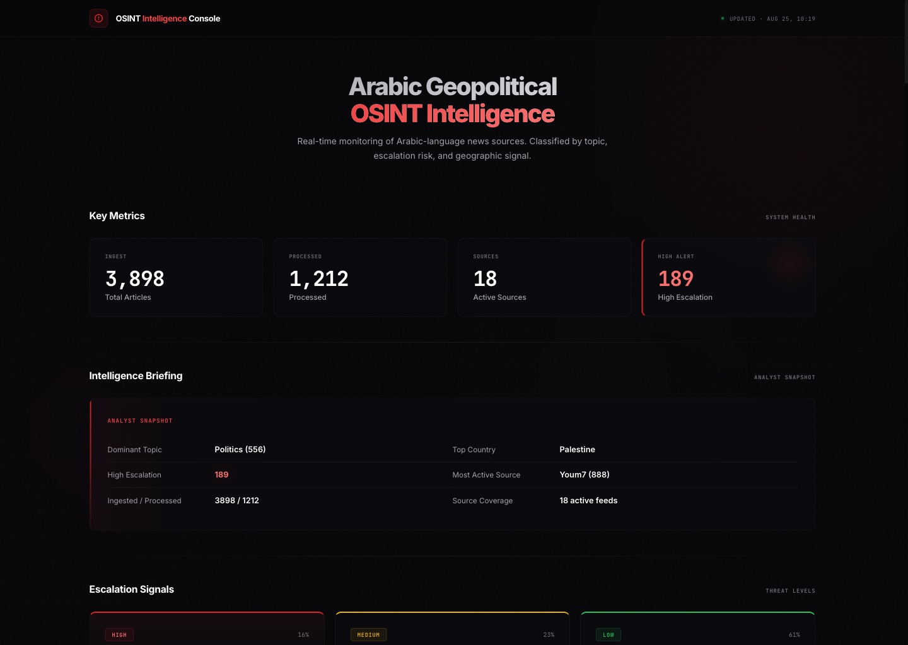
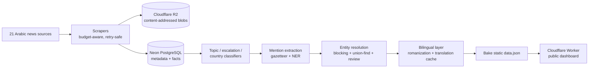
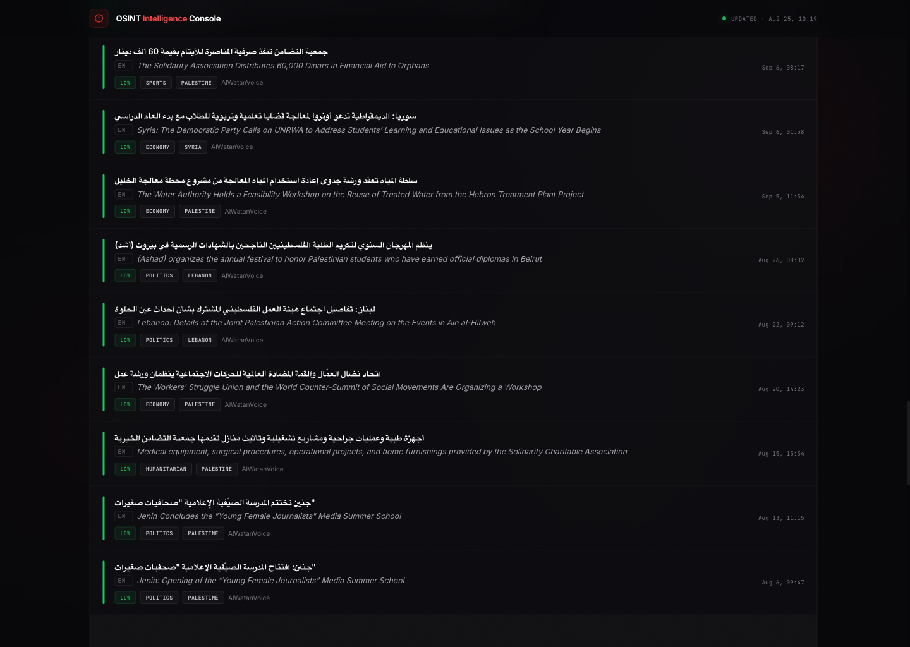

# Arabic OSINT Intelligence Platform


[](https://github.com/gdayoub/arabic-osint-intelligence-platform/actions/workflows/tests.yml)


An **entity resolution and link analysis engine** that continuously ingests
Arabic-language news, extracts the people, places and organizations it
mentions, and resolves them into a single evidenced set of real-world
entities, with every fact traceable back to the exact sentence it came from.

**[Live dashboard →](https://arabic-osint-dashboard.georgedayoub500.workers.dev)**



---

## At a glance

| | |
|---|---|
| **Sources** | 21 Arabic news outlets across 13 countries, scraped every 6 hours |
| **NLP** | Hand-written Aho-Corasick gazetteer (F1 0.90) + transformer NER, CAMeLBERT (F1 0.89) |
| **Entity resolution** | Blocking → learned pair scorer (AUC 0.935) → union-find with a complete-linkage guard → human review queue |
| **Bilingual** | Arabic surface forms, romanization and translations stored as separate facts; English queries find Arabic-only entities |
| **Reliability** | 476 unit tests, property-based tests (Hypothesis), Alembic migrations, 30 ADRs, append-only pipeline ledger |
| **Cost** | $0/month: GitHub Actions + Neon + Cloudflare R2/Workers free tiers, no always-on server |

## How it works

```
Document  →  Mention  →  Entity  →  Graph
(raw text)   (a span     (a real     (typed, evidenced
             of chars)   thing)      relationships)
```



Every 6 hours a GitHub Actions cron job runs the full pipeline. Article text
goes to R2 (gzipped and keyed by content hash), and metadata and facts go to
Postgres. The public dashboard is one static JSON file baked on each run and
served by a Cloudflare Worker, so nothing runs when nobody is viewing it.

### Design principles

The system is built around **provenance**. Every entity, classification and
merge decision records the document, character span and extractor version
that produced it.

1. **Offsets are always valid:** `document.text[start:end] == mention.text`, enforced by tests.
2. **Facts are append-only:** they are superseded, never overwritten, so the system can answer *"what did we believe on date X?"*
3. **Nothing is deleted, only retracted**, and retractions propagate downstream.
4. **Extractors are versioned**, and every output records the version that produced it.
5. **Nothing is domain-hardcoded:** languages and object types are configuration, not Python.

Major architectural decisions are recorded as [ADRs](docs/adr/).

## Engineering highlights

These are real bugs found in production output that shaped the design:

- **Normalization was corrupting stored offsets.** Normalizing text in place
  shifted every mention's character offsets. Now text is normalized only for
  comparison, never in storage, and a test enforces that invariant.
- **The most-mentioned entity was the one being dropped.** One repeated
  string (إيران, "Iran") created an oversized blocking bucket that the
  size guard discarded wholesale. Collapsing byte-identical strings before
  blocking took the corpus from **3,769 fragments to 87 real entities**.
- **A perfect AUC was a bug report.** The first pair scorer hit AUC 1.000
  because its features leaked the label: positive pairs shared a source and
  date. Re-sampling negatives fixed the leak and gave a believable **0.935**.
- **Charset guessing turned Arabic into Cyrillic mojibake.** `chardet`
  overrode correct HTTP headers. The fix trusts the declared charset first,
  then UTF-8, and uses statistical detection only as a last resort.
- **One dead source cancelled every scheduled run.** With 21 sources and no
  per-source time budget, a single hanging site consumed the whole 30-minute
  CI window. A per-source budget now degrades it to a partial result instead.

## Dashboard



## Roadmap

| Milestone | Status | Scope |
|---|---|---|
| M1: Provenance foundation | ✅ | Every fact traces to document, span and extractor version |
| M1.5: Hosting & storage | ✅ | R2 blob storage + Neon Postgres, $0 hosting |
| M2: Language adapters | ✅ | Arabic + English behind one `LanguageAdapter` interface |
| M3: Mention extraction | ✅ | Gazetteer + transformer NER |
| M4: Entity resolution | ✅ | Blocking, learned scorer, union-find, review queue |
| M5: Bilingual layer | 🟡 | Romanization + bidirectional Arabic/English search |
| M6: Links & graph | ⬜ | Typed, evidenced relationships between entities |
| M7: Events & geography | ⬜ | Event extraction, date resolution, place gazetteer |

## Tech stack

**Python 3.11** · **PostgreSQL** (Neon) · **SQLAlchemy 2** · **Alembic** ·
**Cloudflare R2 & Workers** · **requests / BeautifulSoup** · **CAMeLBERT** ·
**pytest + Hypothesis** · **GitHub Actions**

## Project structure

```text
src/
├── scraping/     # 21 per-source scrapers on a shared BaseScraper
├── pipeline/     # ingest → process → extract → resolve → translate → bake
├── extract/      # gazetteer + NER mention extraction
├── resolve/      # blocking, pair scoring, union-find
├── lang/         # Arabic/English LanguageAdapter, romanization
├── store/        # ORM, provenance, blob storage
├── ops/          # pipeline ledger, orchestration, health checks
└── search/       # bidirectional entity search
migrations/       # Alembic schema migrations
tests/            # unit, integration (Postgres) and golden name-pair sets
docs/adr/         # architecture decision records
```

## Run locally

```bash
git clone https://github.com/gdayoub/arabic-osint-intelligence-platform.git
cd arabic-osint-intelligence-platform
python3.11 -m venv .venv && source .venv/bin/activate
pip install -r requirements.txt
cp .env.example .env          # set DATABASE_URL to a local Postgres

python main.py init-core-db
python main.py run-core-pipeline --run-id local-dev --limit-per-source 10
```

Run the tests:

```bash
pytest tests/unit -q
```

The suite includes Hypothesis property tests for Arabic normalization
(idempotence and offset stability under arbitrary Unicode) and a
hand-labeled golden set of Arabic name pairs that pins down which names
should and should not resolve to the same entity.

## Author

**George Dayoub**: [GitHub](https://github.com/gdayoub) · [Portfolio](https://george-dayoub-portfolio.vercel.app)

## License

[MIT](LICENSE)
