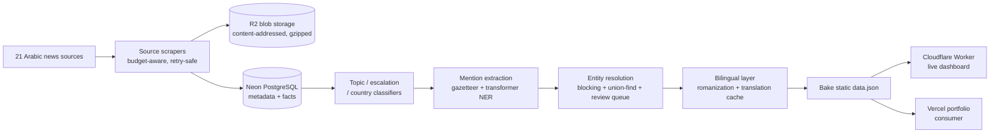
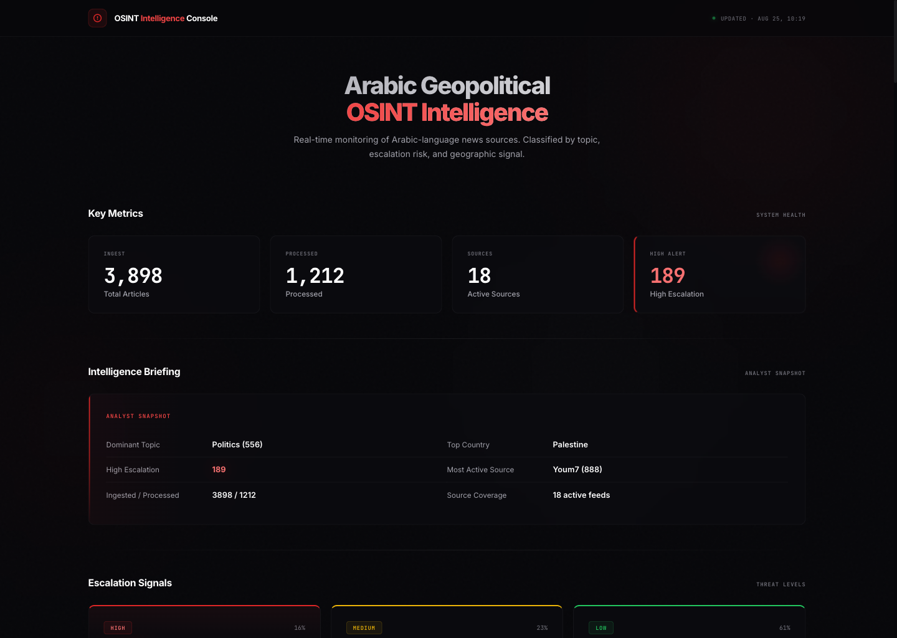
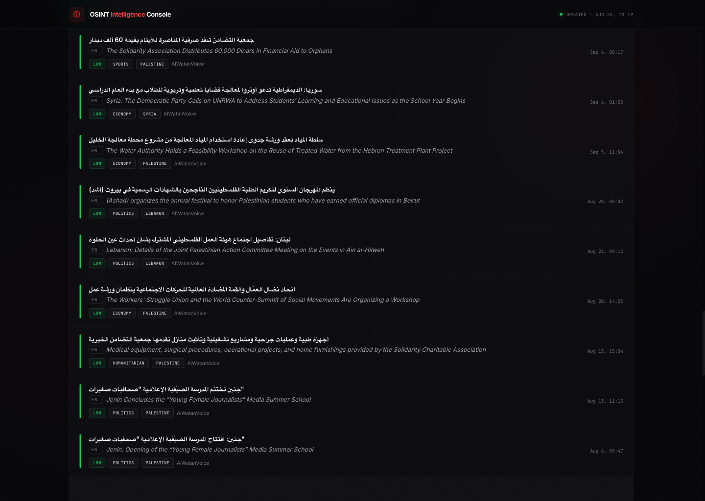

# Arabic OSINT Intelligence Platform


**Live dashboard:** [arabic-osint-dashboard.georgedayoub500.workers.dev](https://arabic-osint-dashboard.georgedayoub500.workers.dev)
**Also embedded in my portfolio:** [george-dayoub-portfolio.vercel.app/osint-dashboard.html](https://george-dayoub-portfolio.vercel.app/osint-dashboard.html)

---

## What this actually is

I made this **entity resolution and link analysis engine**  
the system that sits behind real intelligence
tooling built with Arabic language OSINT as its first domain, but designed
so language and object types are configuration, never Python. The
architecture doesn't know it's Arabic. It doesn't know it's news!!.

```
Document  →  Mention  →  Entity  →  Graph
 (raw text)   (a span      (a real      (typed,
              of chars)    thing)       evidenced
                                        relationships)
```

Every fact the system produces — every entity, every classification, every
merge decision — traces back to the exact document, character span, and
extractor version that produced it. Nothing is asserted without evidence,
and nothing is silently overwritten: facts are append-only, retracted by
state transition rather than deleted, so the system can always answer "what
did we believe as of a given date."

## Why it's worth a look

- **21 Arabic news sources**, spanning Palestine, Jordan, Morocco, Iraq,
  Tunisia, Kuwait, Sudan, Yemen, Bahrain, Syria, Egypt, Libya, and Lebanon —
  each with hand-verified scrapers (every one of them broke in a different
  way; see [Engineering highlights](#engineering-highlights)).
- **Entity resolution that's actually evidenced**: a hand-written Aho-Corasick
  gazetteer plus a transformer NER model, deduplicated through blocking,
  union-find with a complete-linkage guard, and a review queue for the pairs
  a human should actually decide — not a black box.
- **Bilingual by design**: Arabic surface forms, romanization, and
  machine-translated evidence are stored as distinct, queryable facts, so an
  English-language query can find an Arabic-only entity without losing the
  original wording.
- **Zero idle cost.** The entire public dashboard is static JSON baked by a
  GitHub Actions cron job and served from a Cloudflare Worker so no server
  runs when nobody's looking at it.

## Architecture



Runs entirely on free tiers: GitHub Actions (cron, every 6 hours) drives the
whole pipeline, writes go to Neon Postgres and Cloudflare R2, and the public
artifact is a single content-addressed JSON file so no always-on API, no
server bill.

## Dashboard





## Engineering highlights

A few of the bugs that shaped the design — the kind of thing tests don't
catch and only real output reveals:

- **Normalization was silently corrupting stored offsets.** Early on,
  normalization shortened stored text in place, which meant every mention's
  character offsets pointed at the wrong span. Fix: normalize only for
  comparison, never touch what's stored. This is now a hard invariant with
  its own test (`document.text[start:end] == mention.text`, always).
- **The most-mentioned entity in the corpus was the one getting dropped.**
  A single repeated Arabic string (إيران, "Iran") produced one oversized
  blocking bucket that blew past the block-size guard and got discarded
  wholesale — so the *most* mentioned entities were the *most* likely to
  vanish. Fix: collapse byte identical strings before blocking. Entity count
  went from 3,769 phantom fragments to 87 real ones.
- **A perfect AUC score was a bug report, not a win.** The first pair
  scorer hit AUC 1.000 because its training features leaked the label,
  positive pairs happened to share a source and land a day apart, negatives
  didn't, so the model learned `same_source` instead of learning names.
  Redrawing negative examples from a seeded RNG dropped AUC to a believable
  0.935.
- **A charset guess turned Arabic headlines into Cyrillic mojibake.**
  `chardet`'s statistical guess beat the HTTP header's declared charset
  often enough that real CNN Arabic headlines were stored as garbage, which
  a translation API then "faithfully" translated into nonsense. Fixed by
  trusting the declared header first, UTF-8 second, statistics last.
- **Every scheduled pipeline run was silently timing out.** Once the source
  count grew to 21, `BaseScraper` had no wall-clock budget at all — one slow
  or half-dead source could consume the entire 30-minute GitHub Actions
  window, and every run since got cancelled before publishing anything. Fixed
  with a per-source time budget enforced inside the fetch loop, so one dead
  source degrades to a partial yield instead of blocking every source queued
  behind it.

## What's built vs. what's next

| Milestone | Status | What it covers |
|---|---|---|
| M1 — Provenance foundation | ✅ Done | Every fact traces to a document, span, and extractor version |
| M1.5 — Hosting & storage | ✅ Done | R2 blob storage + Neon Postgres, migrated off a paid host |
| M2 — Language adapters | ✅ Done | Arabic + English behind one `LanguageAdapter` interface |
| M3 — Mention extraction | ✅ Done | Gazetteer (F1 0.90) + transformer NER (F1 0.89) |
| M4 — Entity resolution | ✅ Done | Blocking, learned scorer, union-find, human review queue |
| M5 — Bilingual layer | 🟡 In progress | Romanization + bidirectional Arabic/English search |
| M6 — Links & graph | ⬜ Not started | Typed, evidenced relationships between entities |
| M7 — Events & geography | ⬜ Not started | Event extraction, date resolution, place gazetteer |
| M8+ — Reliability, alerting, API | ⬜ Not started | See `docs/AGENT_BRIEF.md` for the full roadmap |

## Non-negotiable principles

The rules that hold even when a shortcut would pass tests:

1. Every derived fact records its origin — document, span, extractor, version.
2. Character offsets are always valid: `text[start:end] == mention_text`.
3. Nothing is domain-hardcoded — object types and languages are config.
4. Extractors are versioned; every output records which version produced it.
5. Facts are append-only — superseded, never overwritten in place.
6. Nothing is deleted, only retracted, and retraction propagates downstream.
7. No performance change ships without a before/after benchmark.

## Tech stack

- **Language:** Python 3.11
- **Database:** PostgreSQL 16 (Neon, serverless), SQLAlchemy 2, Alembic migrations
- **Storage:** Cloudflare R2 (content-addressed, gzipped article text)
- **Scraping:** `requests` + `beautifulsoup4`, per-source selector isolation, budget-aware retry
- **NLP:** hand-written Aho-Corasick gazetteer, transformer NER (CAMeLBERT), custom Arabic normalization
- **Entity resolution:** blocking, a learned pair scorer, union-find with complete-linkage guard
- **Testing:** pytest, Hypothesis (property-based testing for text normalization)
- **CI/CD:** GitHub Actions — scheduled ingestion, migration gates, contract checks, public smoke tests
- **Serving:** static JSON baked every run, Cloudflare Workers, zero always-on compute

## Repository layout

```text
arabic_osint_platform/
├── src/
│   ├── scraping/        # 21 per-source scrapers, shared BaseScraper
│   ├── pipeline/        # ingest -> process -> extract -> resolve -> translate -> bake
│   ├── resolve/         # blocking, pair scoring, union-find
│   ├── lang/            # Arabic/English LanguageAdapter, romanization
│   ├── store/           # SQLAlchemy ORM, provenance, blob storage
│   ├── ops/             # ledger, runtime orchestration, health
│   └── search/          # bidirectional entity search
├── migrations/          # Alembic, one linear head
├── tests/
│   ├── unit/            # 476 tests
│   ├── integration/     # Postgres-backed migration tests
│   └── golden/          # hand-labeled Arabic name pairs
├── docs/
│   ├── adr/             # one ADR per real architectural decision
│   └── AGENT_BRIEF.md   # the full spec and milestone roadmap
├── .github/workflows/   # scheduled pipeline, tests, contract checks
└── main.py              # CLI entry point
```

## Running locally

```bash
git clone https://github.com/gdayoub/arabic-osint-intelligence-platform.git
cd arabic_osint_platform
python3.11 -m venv .venv
source .venv/bin/activate
pip install -r requirements.txt
cp .env.example .env   # point DATABASE_URL at a local/dev Postgres

python main.py init-core-db
python main.py run-core-pipeline --run-id local-dev-1 --limit-per-source 10
```

## Testing

```bash
pytest tests/unit -q
```

476 tests: unit coverage over the full pipeline, Hypothesis property based
tests for Arabic normalization (idempotence, offset stability under any
Unicode input), and a hand labeled  set of Arabic name pairs that
locks in exactly which names should and shouldn't resolve to the same
entity.


